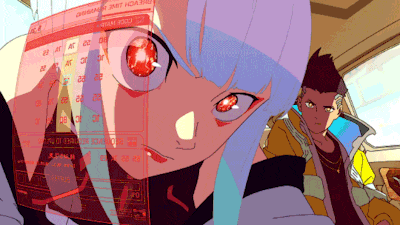

<!-- ═══════════════════════ HEADER ═══════════════════════ -->
<div align="center">


<a href="https://git.io/typing-svg">
  
</a>

<br/><br/>

[](mailto:j.alcino.dev@outlook.com)
[](https://www.linkedin.com/in/john-alcino/)
[](https://github.com/John258-io)

</div>

<br/>

<!-- ═══════════════════════ SOBRE ═══════════════════════ -->
<h2 align="center">⌁ Sobre mim ⌁</h2>

<table align="center">
<tr>
<td width="62%" valign="top">

Olá! Sou o **João Alcino Vilanculos** — estudante de **Engenharia de Tecnologias e Sistemas de Informação** na **Universidade Joaquim Chissano**, em Moçambique.

Neste momento estou a aprofundar o desenvolvimento web na formação **Junior Full Stack Development** da **Bytes4FUTURE**.

Gosto de criar aplicações **úteis, funcionais e bonitas**, unindo programação com a minha experiência em **design e comunicação visual**.

<br/>

```yaml
nome:       João Alcino Vilanculos
foco:       Full Stack Development
estudo:     Eng. Tecnologias e Sistemas de Informação
formação:   Junior Full Stack — Bytes4FUTURE
localização: Maputo, Moçambique
```

</td>
<td width="38%" align="center" valign="middle">



</td>
</tr>
</table>

<br/>

<!-- ═══════════════════════ STACK ═══════════════════════ -->
<h2 align="center">⌁ Stack &amp; Ferramentas ⌁</h2>

<div align="center">


</div>

<br/>

<!-- ═══════════════════════ STATS ═══════════════════════ -->
<h2 align="center">⌁ Estatísticas ⌁</h2>

<div align="center">


</div>

<br/>

<!-- ═══════════════════════ SNAKE ═══════════════════════ -->
<div align="center">

<picture>
  <source media="(prefers-color-scheme: dark)" srcset="https://raw.githubusercontent.com/John258-io/John258-io/output/github-contribution-grid-snake-dark.svg">
  <source media="(prefers-color-scheme: light)" srcset="https://raw.githubusercontent.com/John258-io/John258-io/output/github-contribution-grid-snake.svg">
  
</picture>

</div>

<!-- ═══════════════════════ FOOTER ═══════════════════════ -->


<div align="center">
  <sub>Feito com ☕ e código em Maputo · <b>João Alcino</b></sub>
</div>
