<!-- ═══════════════════════ HEADER ═══════════════════════ -->

  

 

<!-- ═══════════════════════ SOBRE ═══════════════════════ -->
<h2 align="center">⌁ Sobre mim ⌁</h2>

<table align="center">
<tr>
<td width="60%" valign="top">

Olá! Sou o **João Alcino Vilanculos**, estudante de **Engenharia de Tecnologias e Sistemas de Informação** na **Universidade Joaquim Chissano**, em Moçambique.

Neste momento estou a aprofundar o desenvolvimento web na formação **Junior Full Stack Development** da **Bytes4FUTURE**.

Gosto de criar aplicações **úteis, funcionais e bonitas**, unindo programação com a minha experiência em **design e comunicação visual**.

</td>
<td width="40%" align="center" valign="middle">

</td>
</tr>
</table>

 

<!-- ═══════════════════════ A APRENDER ═══════════════════════ -->
<h2 align="center">⌁ Foco actual ⌁</h2>

<table align="center">
<tr>
<td width="50%" align="center" valign="middle">

</td>
<td width="50%" align="center" valign="middle">

</td>
</tr>
</table>

 

<!-- ═══════════════════════ STACK ═══════════════════════ -->
<h2 align="center">⌁ Stack &amp; Ferramentas ⌁</h2>

 

<!-- ═══════════════════════ STATS ═══════════════════════ -->
<h2 align="center">⌁ Estatísticas ⌁</h2>

<picture>
  <source media="(prefers-color-scheme: dark)" srcset="https://github-readme-stats-two-omega-43.vercel.app/api?username=John258-io&show_icons=true&locale=pt-br&commits_year=2026&count_private=true&hide=contribs&cache_seconds=21600&bg_color=0D1117&title_color=38BDF8&text_color=E6EDF3&icon_color=38BDF8&border_color=1F6FEB&ring_color=38BDF8&custom_title=Estat%C3%ADsticas%20do%20GitHub">
  <source media="(prefers-color-scheme: light)" srcset="https://github-readme-stats-two-omega-43.vercel.app/api?username=John258-io&show_icons=true&locale=pt-br&commits_year=2026&count_private=true&hide=contribs&cache_seconds=21600&bg_color=FFFFFF&title_color=0284C7&text_color=24292F&icon_color=0EA5E9&border_color=BAE6FD&ring_color=0EA5E9&custom_title=Estat%C3%ADsticas%20do%20GitHub">
  
</picture>
<picture>
  <source media="(prefers-color-scheme: dark)" srcset="https://github-readme-stats-two-omega-43.vercel.app/api/top-langs/?username=John258-io&layout=compact&langs_count=8&custom_title=Linguagens&bg_color=0D1117&title_color=38BDF8&text_color=E6EDF3&border_color=1F6FEB">
  <source media="(prefers-color-scheme: light)" srcset="https://github-readme-stats-two-omega-43.vercel.app/api/top-langs/?username=John258-io&layout=compact&langs_count=8&custom_title=Linguagens&bg_color=FFFFFF&title_color=0284C7&text_color=24292F&border_color=BAE6FD">
  
</picture>

 

<!-- ═══════════════════════ SNAKE ═══════════════════════ -->

<picture>
  <source media="(prefers-color-scheme: dark)" srcset="https://raw.githubusercontent.com/John258-io/John258-io/output/github-contribution-grid-snake-dark.svg">
  <source media="(prefers-color-scheme: light)" srcset="https://raw.githubusercontent.com/John258-io/John258-io/output/github-contribution-grid-snake.svg">
  
</picture>

<!-- ═══════════════════════ FOOTER ═══════════════════════ -->

  Feito com ☕ e código em Maputo · <b>João Alcino</b>

